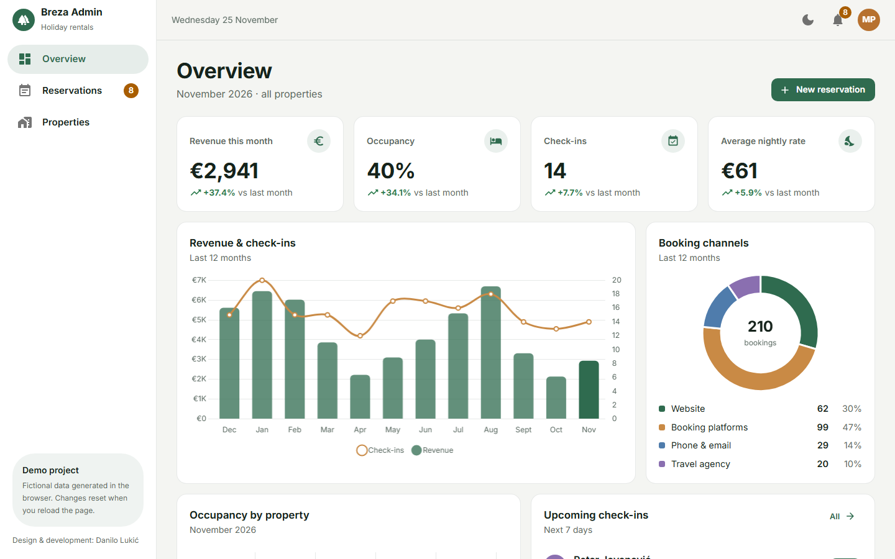
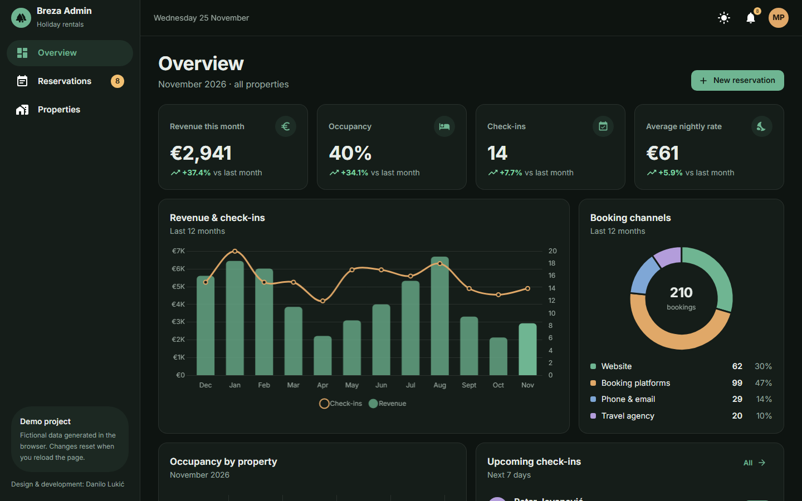
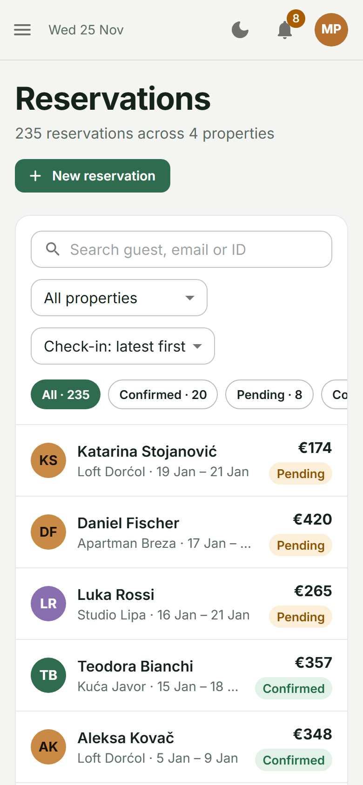

# Breza Admin – holiday rental dashboard

An admin dashboard for a small holiday-rental business: revenue and occupancy at a glance, a searchable reservations table, booking management and per-property performance.

**Live demo:** https://danilo3110.github.io/rental-admin-dashboard/

| Overview (light) | Overview (dark) |
|---|---|
|  |  |

<p align="center"></p>

## Features

- **Overview:** KPIs compared with the previous month, revenue and check-ins for the last 12 months (combined bar and line chart), booking channels, occupancy per property and upcoming check-ins.
- **Reservations:**
  - search that ignores case and diacritics, filters by status and property, sorting and pagination
  - filters, sorting and the "new reservation" dialog live in the URL, so a filtered view can be shared as a link
  - details drawer with confirm / cancel actions (cancelling asks for confirmation)
  - new reservation form that checks for overlapping bookings and shows the price as you type
  - card list instead of a table on small screens
- **Properties:** occupancy, revenue and upcoming arrivals for each property.
- **Light and dark theme**, remembered between visits.
- **Loading and error states:** skeletons, retry on failure, toast notifications. Add `?apiError` to the URL to see the error state.
- **Unit tests** for statistics, filtering, overlap detection, validation and the data generator.

## Tech stack

React 19 · Redux Toolkit · React Router · Material UI · Chart.js · Formik · Vite · Vitest

Some details worth a look:

- `createAsyncThunk` with a `condition`, `createEntityAdapter`, memoized selectors and a listener middleware that persists the theme (`src/store/`)
- pure, tested functions for all calculations (`src/utils/`), kept separate from React and Redux
- route-level code splitting with `React.lazy`, and Chart.js / MUI in separate chunks

## Getting started

```bash
npm install
npm run dev        # http://127.0.0.1:5182
npm test           # unit tests
npm run build      # production build in dist/
```

On Windows you can also double-click `start.cmd`.

## How the data works

There is no backend: `src/api/fakeApi.js` generates realistic reservations in the browser (seeded, relative to today's date) and answers with a small delay, like a real API. Changes are kept in memory and reset on reload. Connecting a real backend only means replacing the functions in that file.

## Project structure

```
src/
  api/             fake API (latency, simulated error)
  components/      layout, charts, KPI cards, drawer, dialog
  data/            properties, channels, statuses and the data generator
  pages/           Overview, Reservations, Properties, 404
  store/           Redux slices and selectors
  theme/           MUI theme for light and dark mode
  utils/           dates, pricing, statistics, filtering and validation (with tests)
```

## Deployment

- **GitHub Pages:** `npm run deploy` builds the app for the `/rental-admin-dashboard/` path and publishes it to the `gh-pages` branch. A copy of `index.html` is served as `404.html`, so deep links like `/reservations` work after a refresh.
- **Netlify:** `netlify.toml` is included, with the redirect needed for client-side routing.

## Notes

This is a demo project: all guests, reservations and properties are fictional. Property photos are from [Unsplash](https://unsplash.com).

© 2026 Danilo Lukić. All rights reserved.
